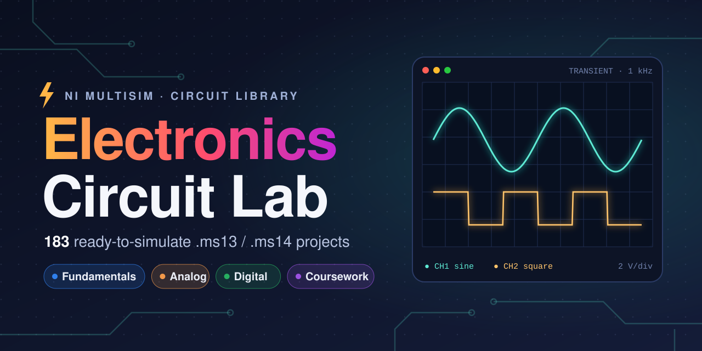
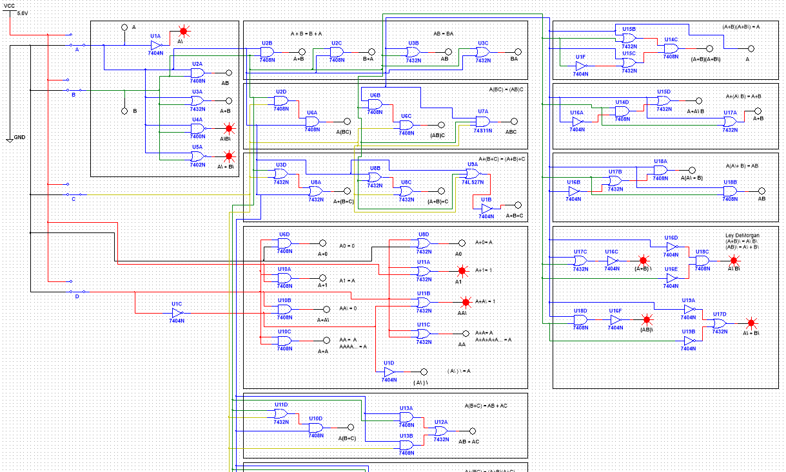
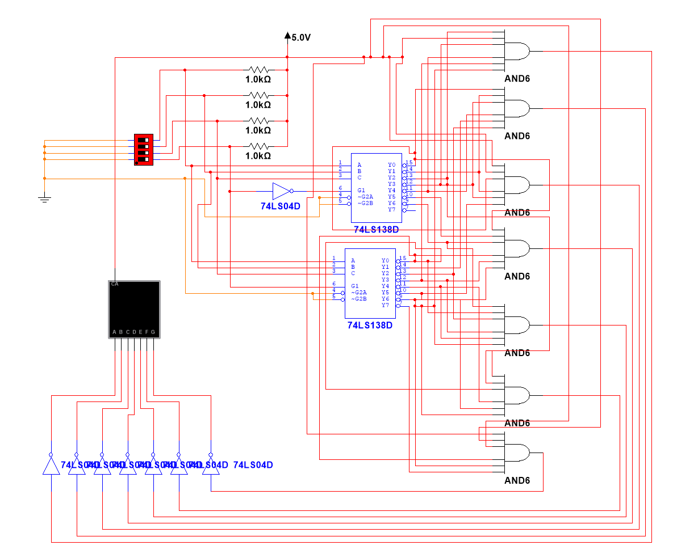

<div align="center">



<p><b>183 ready-to-simulate NI Multisim projects</b> covering circuit theory, analog electronics, digital logic and full university lab coursework.</p>

<p>
  
  
  
  <a href="LICENSE"></a>
</p>

<a href="https://github.com/abdullah-al-faahim/electronics-circuit/archive/refs/heads/main.zip">
  
</a>
<br/>
<a href="https://github.com/abdullah-al-faahim/electronics-circuit/releases/latest/download/fundamentals.zip"></a>
<a href="https://github.com/abdullah-al-faahim/electronics-circuit/releases/latest/download/analog.zip"></a>
<br/>
<a href="https://github.com/abdullah-al-faahim/electronics-circuit/releases/latest/download/digital.zip"></a>
<a href="https://github.com/abdullah-al-faahim/electronics-circuit/releases/latest/download/coursework.zip"></a>

<br/><br/>

<a href="#-getting-started">Getting started</a> ·
<a href="#-whats-inside">What's inside</a> ·
<a href="#-preview">Preview</a> ·
<a href="#-repository-layout">Layout</a> ·
<a href="#-contact">Contact</a>

</div>

---

## 🚀 Getting started

<a href="https://www.ni.com/en-us/support/downloads/software-products/download.multisim.html">
  
</a>

1. **Install NI Multisim 14.2 or newer.** The free trial works.
2. **Get the circuits.** Use one of the download buttons above, or clone the repo:
   ```sh
   git clone https://github.com/abdullah-al-faahim/electronics-circuit.git
   cd electronics-circuit
   ```
3. **Open any `.ms13` / `.ms14` file** in Multisim and press <kbd>F5</kbd> (Run) to simulate.

> [!TIP]
> `.ms13` files were saved in Multisim 13 and open fine in 14.x. Multisim may offer to upgrade the file when you save it.

## 📦 What's inside

<details open>
<summary><b>🔵 01 · Circuit Fundamentals</b> (23 files) · <a href="circuits/01-fundamentals">browse</a></summary>

- **[circuit-simplification](circuits/01-fundamentals/circuit-simplification)** · Series/parallel resistor network reduction
- **[circuit-with-labels](circuits/01-fundamentals/circuit-with-labels)** · A simple labelled schematic for beginners
- **[node-and-mesh-analysis](circuits/01-fundamentals/node-and-mesh-analysis)** · Nodal and mesh analysis, superposition, Thévenin, active power
- **[dc-operating-point](circuits/01-fundamentals/dc-operating-point)** · DC operating point analysis walkthrough
- **[dependent-current-source](circuits/01-fundamentals/dependent-current-source)** · Circuits driven by controlled current sources
- **[dependent-voltage-source](circuits/01-fundamentals/dependent-voltage-source)** · Three versions of controlled voltage source circuits
- **[ac-source-operations](circuits/01-fundamentals/ac-source-operations)** · AC source behaviour and measurement
- **[impedance](circuits/01-fundamentals/impedance)** · Common impedance configurations, with MATLAB cross-checks
- **[steady-state-response](circuits/01-fundamentals/steady-state-response)** · RL circuit transient and steady-state response
- **[transformers](circuits/01-fundamentals/transformers)** · Basic transformer circuit

</details>

<details>
<summary><b>🟠 02 · Analog Electronics</b> (54 files) · <a href="circuits/02-analog">browse</a></summary>

- **[diode-behaviour](circuits/02-analog/diode-behaviour)** · Diode circuit behaviour and characteristics
- **[inverting-opamp](circuits/02-analog/inverting-opamp)** · Inverting op-amp configurations and ideal op-amp exercises
- **[opamp-oscillators-and-amplifiers](circuits/02-analog/opamp-oscillators-and-amplifiers)** · 741 amplifiers, integrator/differentiator, comparator, astable/monostable multivibrators, RC phase-shift and Wien bridge oscillators, square/triangle/sawtooth generators, RC-coupled amplifiers
- **[amplifiers-and-filters](circuits/02-analog/amplifiers-and-filters)** · CE amplifier, FET, low-pass filters, Colpitts oscillator, bandwidth, transistor characteristics, plus the LTC lab sessions

</details>

<details>
<summary><b>🟢 03 · Digital Logic</b> (15 files) · <a href="circuits/03-digital">browse</a></summary>

- **[boolean-operations](circuits/03-digital/boolean-operations)** · Every basic Boolean operation in one sheet
- **[logic-gate-equations](circuits/03-digital/logic-gate-equations)** · Turning Boolean equations into gate circuits
- **[transistor-logic](circuits/03-digital/transistor-logic)** · Logic gates built from discrete transistors
- **[flip-flops](circuits/03-digital/flip-flops)** · SR/JK flip-flop designs, multi-switch variants
- **[debounce-jk-flip-flop](circuits/03-digital/debounce-jk-flip-flop)** · Two-switch debounce sequence with JK flip-flops
- **[bcd-seven-segment](circuits/03-digital/bcd-seven-segment)** · BCD to seven-segment display driver
- **[555-one-shot-clock](circuits/03-digital/555-one-shot-clock)** · 555 timer one-shot clock configuration

</details>

<details>
<summary><b>🟣 04 · Lab &amp; Coursework</b> (91 files) · <a href="circuits/04-coursework">browse</a></summary>

- **[electronics-1-2-lab](circuits/04-coursework/electronics-1-2-lab)** · Full Electronics I &amp; II lab set: RLC series/parallel networks, passive and active filters, BJT/JFET/MOSFET characteristics, op-amp 741 models, controlled sources, attenuator pads, parameter sweeps, two-way switching
- **[microelectronics-textbook-problems](circuits/04-coursework/microelectronics-textbook-problems)** · Worked microelectronics textbook problems 38–70

</details>

## 🖼 Preview

<p align="center">
  <br/>
  <sub><b>Logic Gate Equations</b> · <code>circuits/03-digital/logic-gate-equations</code></sub>
</p>

<p align="center">
  <br/>
  <sub><b>BCD Seven-Segment Display</b> · <code>circuits/03-digital/bcd-seven-segment</code></sub>
</p>

## 🗂 Repository layout

```text
electronics-circuit/
├── circuits/
│   ├── 01-fundamentals/
│   ├── 02-analog/
│   ├── 03-digital/
│   └── 04-coursework/
├── assets/
├── scripts/
└── .github/workflows/
```

The category download buttons point at the [`downloads` release](https://github.com/abdullah-al-faahim/electronics-circuit/releases/latest). It is rebuilt automatically by [`package-downloads.yml`](.github/workflows/package-downloads.yml) whenever something under `circuits/` changes on `main`.

## 🤝 Contributing

Found a bug in a circuit or have one to add? Open an issue or a pull request. Drop new files into the category folder that fits, and use lowercase-hyphenated folder names. The cover and buttons are generated by `scripts/make_cover.py` and `scripts/make_buttons.py`.

## 📄 License

Distributed under the [MIT License](LICENSE).

## 📬 Contact

**Abdullah Al Fahim** · [alfahim604@yahoo.com](mailto:alfahim604@yahoo.com) · [@abdullah-al-faahim](https://github.com/abdullah-al-faahim)

<div align="center"><sub>If this repo helped with your lab, consider giving it a ⭐</sub></div>
